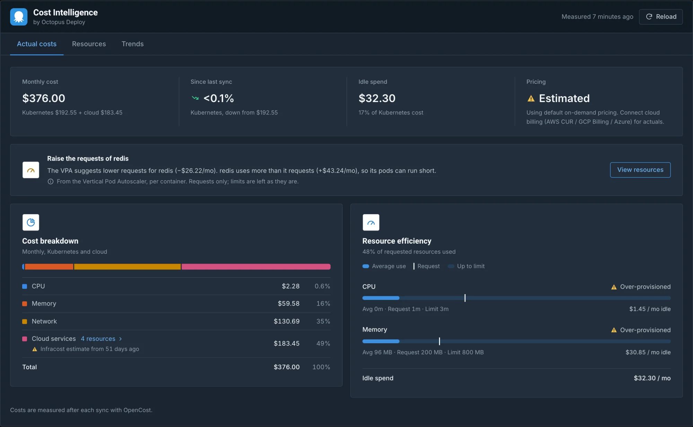
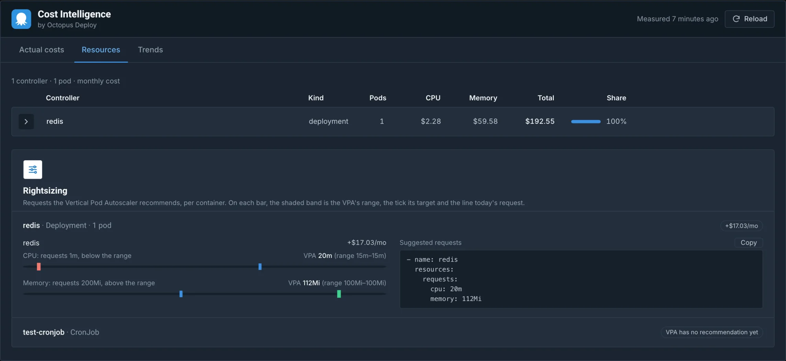
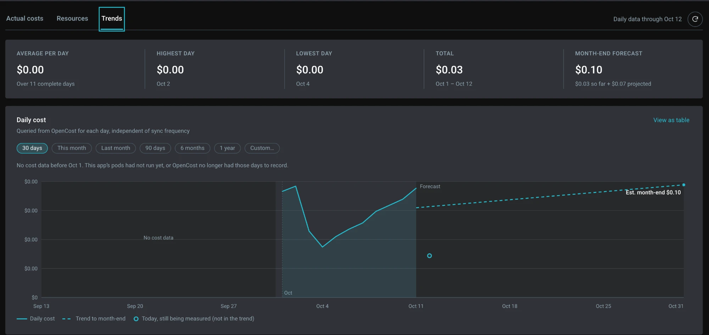
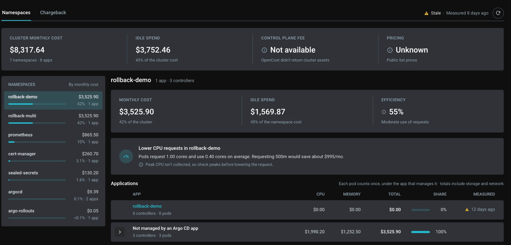
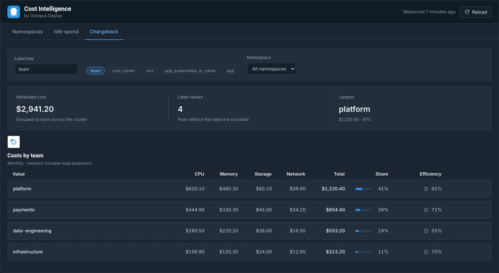

# ArgoCD Cost Intelligence

[](https://github.com/OctopusDeploy/argocd-cost-intelligence/actions/workflows/ci.yml)
[](https://argocd-cost-intelligence.readthedocs.io/)
[](LICENSE)
[](https://github.com/OctopusDeploy/argocd-cost-intelligence/releases)

ArgoCD Cost Intelligence shows what each Argo CD application actually costs, in a **Cost Intelligence** tab inside the Argo CD UI. After every successful sync it asks [OpenCost](https://www.opencost.io) what the application's pods cost and keeps the result, so application owners see their cost where they already work. You need Argo CD and OpenCost running in the same cluster.



## Quick start

Requires Argo CD 3.4 or 3.5, OpenCost 1.121.1+ and Helm 3.8+.

<!-- The release workflow fails a release tag that doesn't match the --version below. -->
```bash
helm install argocd-cost-intelligence \
  oci://ghcr.io/octopusdeploy/charts/argocd-cost-intelligence \
  --version 0.1.0 \
  --namespace argocd-cost-intel --create-namespace \
  --set namespace.create=false \
  --set postgres.auth.password=<your-secure-password> \
  --wait --timeout 10m
```

A post-install hook registers the extension and the notification webhook in Argo CD. If Git manages Argo CD itself, the hook's changes would be reverted: turn it off and follow [Install when Git manages Argo CD](docs/gitops-install.md) instead. On Argo CD 3.5 only the built-in `admin` role can see the tab at first; see [Grant access in Argo CD](docs/installation.md#grant-access-in-argo-cd) for other roles.

Sync an application, wait a few seconds, and open its **Cost Intelligence** tab.

Next: the [installation guide](docs/installation.md) for the OpenCost URL, cluster-wide costs and upgrades, and [configuration](docs/configuration.md) for every setting.

> **Early release (v0.x).** Helm values and the database schema may still change between minor versions; breaking changes are listed in the [CHANGELOG](CHANGELOG.md). This is an independent community project, not affiliated with or endorsed by the Argo project, the CNCF or OpenCost.

## What you get

- **Actual cost per application:** the monthly cost split into CPU, memory, network and storage, counting only the controllers Argo CD manages for that application, plus efficiency (requested against used) and idle spend.
- **Trends:** a daily cost history of up to a year, a forecast and anomaly notices. The history is kept in PostgreSQL, so it outlives OpenCost's Prometheus retention.
- **Namespaces, idle spend, chargeback and cluster overhead:** a system-level page with the cost per namespace, the applications ranked by idle spend, the cost per Kubernetes label, and the control-plane fee, for the people you choose ([Choose your settings](docs/installation.md#choose-your-settings)).
- **Rightsizing, optional:** request suggestions from the [Vertical Pod Autoscaler](https://github.com/kubernetes/autoscaler/tree/master/vertical-pod-autoscaler) or [Goldilocks](https://goldilocks.docs.fairwinds.com/), priced with OpenCost ([Optional: rightsizing](docs/installation.md#optional-rightsizing)).
- **Cloud service costs, optional:** [Infracost](https://www.infracost.io/) estimates for RDS, S3 and other services OpenCost can't see, pushed from CI and shown next to the Kubernetes cost ([Optional: cloud service costs](docs/installation.md#optional-cloud-service-costs)).
- **Prometheus metrics, optional:** the cost of each Application per hour, labelled to join with `argocd_app_info`, plus recording rules and alerts ([Prometheus metrics](docs/metrics.md)).

<details markdown="1">
<summary>More screenshots</summary>





The system page, for people who can see cluster-wide costs:





These come from a small test cluster in the Argo CD dark theme, so the amounts are small.

</details>

## Documentation

The guides are also published at [argocd-cost-intelligence.readthedocs.io](https://argocd-cost-intelligence.readthedocs.io/).

| I want to... | Read |
|---|---|
| Install the plugin, upgrade it or remove it | [Installation](docs/installation.md) |
| Install it when Git manages Argo CD | [Install when Git manages Argo CD](docs/gitops-install.md) |
| Look up a Helm value or manage secrets | [Configuration](docs/configuration.md) |
| Fix a problem, understand the NetworkPolicy, back up the database | [Operations](docs/operations.md) |
| Scrape cost and health metrics, query them, alert on them | [Prometheus metrics](docs/metrics.md) |
| Understand how it works inside | [Architecture](docs/architecture.md) |
| Build it, run the tests, try it locally | [Development](docs/development.md) |
| Work on the Argo CD UI plugin | [ui/README.md](ui/README.md) |

## Contributing

Issues and pull requests are welcome. Read [CONTRIBUTING.md](CONTRIBUTING.md) first; commits need a DCO sign-off (`git commit -s`). Please report vulnerabilities privately as described in [SECURITY.md](SECURITY.md), and follow the [Code of Conduct](CODE_OF_CONDUCT.md).

## License

Licensed under the [Apache License, Version 2.0](LICENSE).
