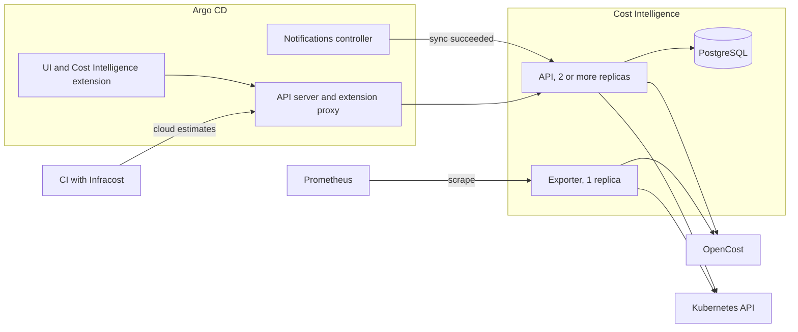

# Architecture

This page explains how Cost Intelligence is put together and why it works the way it does. If you want to know what the figures on the tab mean, read [How costs are measured](how-costs-are-measured.md), and for what it supports and what it doesn't do, read [Limits and requirements](limits-and-requirements.md). Building and testing it is covered in [Development](development.md).

## Overview

Cost Intelligence records what each Argo CD application actually costs. Every time an application syncs successfully, Argo CD Notifications calls a webhook on the service, which asks OpenCost what the application's namespace cost over the last 24 hours, works out the application's own share of it and stores the result in PostgreSQL. The UI extension reads those records through Argo CD's extension proxy and shows them in a Cost Intelligence tab, and a separate exporter publishes application costs as Prometheus metrics.

## Components

The API is the main service and runs as several replicas. It receives the sync webhook, measures and stores cost and serves the REST API that the UI extension calls. Unless you turn them off, every replica also runs two jobs in the background: one measures the applications that have no cost yet when the replica starts, and the other records each application's cost per day. Each replica serves its own health metrics on a separate port.

The exporter is the same binary started in exporter mode, and it always runs as a single replica. Every few minutes it lists the Applications, asks OpenCost what each one cost over the last hour and publishes that as Prometheus metrics. The only thing it reads from the database is the cloud service estimates.

The UI extension is a React bundle that adds a Cost Intelligence tab to each application and a cluster-wide page to Argo CD's sidebar. A small Deployment serves the bundle and an init container on `argocd-server` loads it. It doesn't ship its own React and uses the one Argo CD already loads.

PostgreSQL holds a cost record for each measurement, the latest cloud service estimate for each application and each application's cost per day. The chart runs one in the cluster, or you can point the service at your own.

OpenCost is the only source of Kubernetes cost, and it measures the cluster it runs in from the Prometheus it reads. The service relies on Argo CD for the sync notifications, for the extension proxy and for the RBAC check the proxy does on every request from the UI or CI. It only reads from the Kubernetes API: Argo CD Applications, its own Deployment to find the Application that installed it, and Vertical Pod Autoscalers when rightsizing is on. Infracost is optional and runs in your CI, for cloud services the cluster can't see such as RDS or S3, and CI pushes its estimate through Argo CD's extension proxy like any other request.

## How cost is measured

### After a sync

The notification Argo CD sends carries the Application's namespace and name, where it deploys (a namespace and a cluster) and the resources Argo CD manages for it. The API checks the webhook's bearer token, answers `202 Accepted` straight away and does the measurement in the background, so the notifications controller never waits on OpenCost. If too many measurements are already running it answers `429` instead of queuing more. An application that deploys to another cluster gets a `200` and isn't measured, because the OpenCost in this cluster can't see it ([Only this cluster is measured](limits-and-requirements.md#only-this-cluster-is-measured)).

The measurement waits a few seconds so that OpenCost can catch up with the sync, and then asks it for the namespace's cost, its efficiency and its pods over the last 24 hours. From those pods it picks the ones owned by the workloads in the notification, which gives the application's own cost, and it projects both the namespace's figure and the application's onto a month before storing the record.

Right after a first deploy OpenCost often has no data for the namespace yet, and in that case nothing is stored. The service tries again a few times over the next 15 minutes, and if there's still nothing it waits for the next sync.

### When the service starts

A fresh install would show nothing until every application had synced at least once, so when an API replica starts it lists the Argo CD Applications and measures each one that has no record yet, in the same way a sync would, including the retries while OpenCost has no data yet. The replicas take turns through a lock in the database, so OpenCost is asked about each namespace once and not once per replica. A record measured this way is labelled "Measured at install" on the tab, and since no sync came before it, it's never used as the baseline for a change since the last sync.

### Every day

OpenCost can only answer for the days its Prometheus still keeps, which is often 15. To keep a longer history, every API replica records once an hour the cost of each day that has ended, for every application that has a record, and keeps those days for 400 days by default. The Trends tab reads the stored days and goes to OpenCost only for the days that haven't been recorded yet, such as today. Two replicas may record the same day at the same time, but they store the same figures and a day is written as an upsert, so the job doesn't need a leader.

### For Prometheus

The exporter publishes each application's measured cost per hour over the last hour, split by resource, along with the idle part of it and the cloud service estimates CI pushed. Monthly projections, the change since a sync and anomalies aren't exported, and are left to PromQL and to the recording rules that come with the chart. [Prometheus metrics](metrics.md) lists the metrics and explains why the exporter runs as a single replica.

## Design decisions

### Monthly figures come from the period measured

OpenCost reports a namespace only from the moment its first pod ran, so a namespace created six hours ago has six hours of data in a 24-hour window. The service projects each cost onto a 30-day month from the period OpenCost actually measured. A namespace that cost $5 over a full day is projected to $150 a month, and a new one that cost $1 in its first six hours is projected to $120, where multiplying the 24-hour cost by 30 would have put it at $30. Less than 5 minutes of data is too little to project from, so it's treated as no data.

The 24-hour window is a trade-off between including off-peak hours and smoothing out short spikes on one side, and showing the effect of a sync within a day on the other.

### An application is not its namespace

OpenCost is queried by namespace, but several applications can share one, so each record holds two figures. One is the whole namespace, and the other is the application's own share, computed from the pods of the workloads Argo CD listed for it, where a CronJob's Jobs and a Rollout's ReplicaSets count under their parent.

Application views show the application's share and namespace views show the namespace, and the two are never compared with each other. When the cluster-wide page adds up namespaces it counts each namespace once, and never sums the applications inside it. Records stored before the service measured the application's share, or sent by a notifications template that leaves out the resources, have only the namespace figure, and the UI says so.

An application is identified by its namespace together with its name. With apps in any namespace enabled, `team-a/web` and `team-b/web` are two different applications.

### Unknown is not zero

When OpenCost hasn't measured a namespace yet, its cost is unknown, which is not the same as $0. The service stores nothing for it, because a stored $0 would show up on the tab as if it were a real figure.

### Idle cost is computed from pods

Idle cost is the part of the CPU and memory cost spent on capacity the pods requested but didn't use. The service works it out per pod from the pod's request, its usage and its cost, and doesn't use OpenCost's own idle fields, which are always zero up to OpenCost 1.121.3.

### Rightsizing is advice from VPAs

Rightsizing reads the Vertical Pod Autoscalers in the application's namespace. Only a VPA in `Off` mode counts as advice, and a VPA in any other mode already sets the requests itself, so the tab shows that workload as managed. A recommendation is used once the VPA has a day of history, which covers a full daily load cycle. Current requests and the possible savings come from OpenCost and not from the manifests, so they're priced the same way as the cost on the rest of the tab. Only requests are ever suggested, never limits.

## Authorization

Requests from the UI and from CI reach the service through Argo CD's extension proxy. The proxy checks that the viewer is allowed to see the Application named in the `Argocd-Application-Name` header, but it doesn't check that the request is actually about that Application, so the service does that part itself.

On application routes the service serves data only for the Application the header names, matched on both its namespace and its name. The cluster-wide routes behind the Namespaces, Idle spend and Chargeback pages need the header to name one specific Application that stands for cluster-wide access, and anyone who may see that Application may see cluster-wide costs. By default it's the Application that installed Cost Intelligence, which the service finds from Argo CD's tracking annotation on its own Deployment. When you install it with Helm directly there's no such Application, so the chart creates an empty access Application for this, which deploys nothing and is never measured. You can also name the Application yourself or turn the cluster-wide routes off, as described in [Choose your settings](installation.md#choose-your-settings).

The webhook doesn't go through the proxy, so there's no header to vouch for it and it needs a bearer token instead. The chart generates the token, unless you bring your own secret, and gives it to Argo CD Notifications. The user and group headers are never trusted, because whatever a client sends in them passes straight through the proxy.

All of this depends on nothing else being able to reach the API. The chart's NetworkPolicy admits only Argo CD's server and notifications controller, plus its repo server when the access Application is in use, and it admits only the sources you list in `metrics.allowedFrom` to the metrics port. If your CNI doesn't exempt kubelet probes, it also admits the probe CIDRs you configure. The cost metrics carry every application's cost, so anyone who can query that Prometheus sees them whatever their Argo CD RBAC says. [SECURITY.md](../SECURITY.md) describes the full trust model.

## Extending it

The rest of the service talks to storage through an interface and never to PostgreSQL directly, so another backend can be added behind it. Schema changes are numbered up and down migrations, which the API applies when it starts.

Supporting an IaC cost tool other than Infracost means adding a parser that turns its output into the service's cloud estimate and accepting the tool's name as a source on the estimate route. Storage and the UI already carry the source through.

A new route goes in the authorization group that matches its scope, and an application route never takes a namespace from the caller.

## Deployment

The Helm chart ([installation](installation.md), [configuration](configuration.md)) runs the API with an HPA between 2 and 5 replicas, the exporter as a single replica, the UI Deployment, PostgreSQL and the NetworkPolicy. By default a post-install hook then wires Argo CD up by adding the extension proxy, the notifications webhook, the RBAC rule for the extension and the init container on `argocd-server`. OpenCost and its Prometheus need to be installed beforehand.
